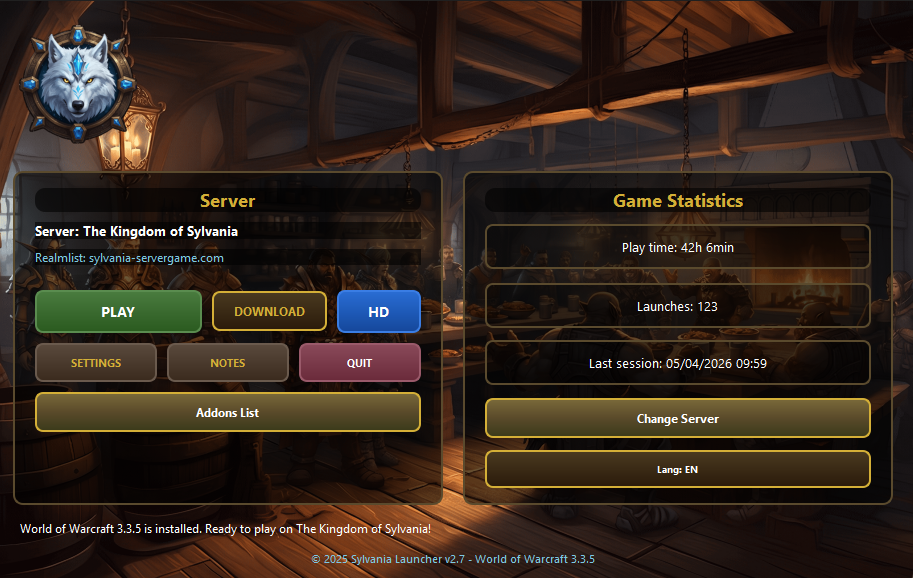
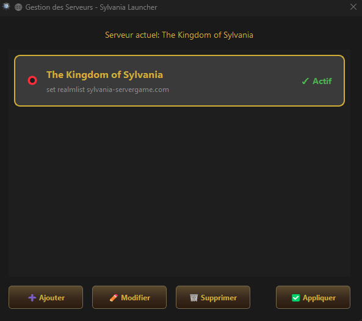
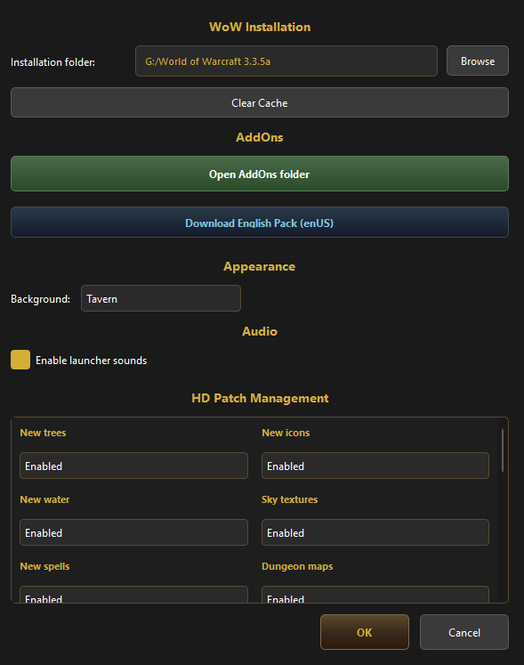
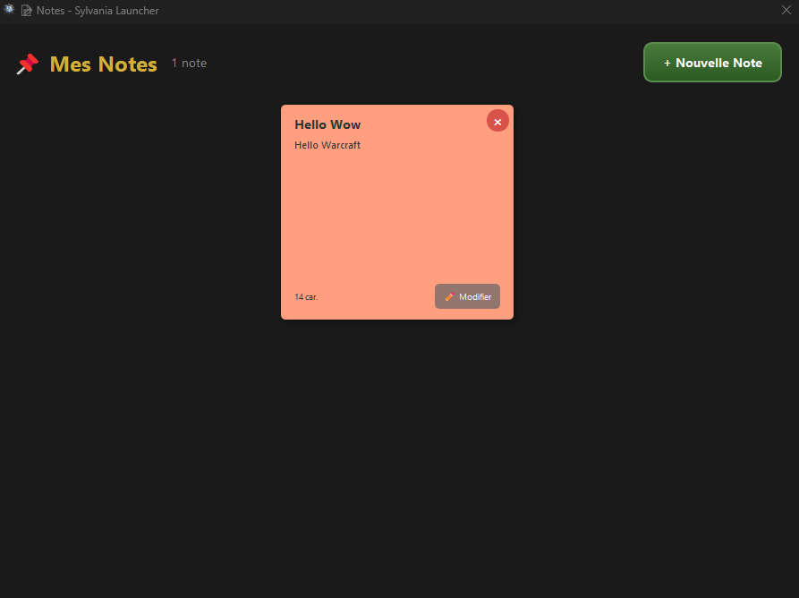

# Sylvania Launcher — Édition Linux 🐧


🎮 **Launcher officiel des serveurs World of Warcraft Sylvania** — WotLK 3.3.5a **et** Legion 7.3.5 (« 2 launchers en 1 »), version native Linux distribuée en **AppImage** avec **Wine embarqué**.

> 🪟 **Vous êtes sous Windows ?** La version Windows se trouve sur la branche [`master`](https://github.com/BlaMacfly/SylvaniaLauncher/tree/master).
> Cette branche `linux` ne concerne que l'édition Linux.

## Aperçu

### Interface Principale


### Gestion des Serveurs


### Réglages


### Notes (Style Post-it)


## Spécificités de l'édition Linux

- 📦 **Format AppImage** : un seul fichier, aucune installation système requise — **ni Wine ni Qt** ne doivent être installés sur la machine.
- 🍷 **Wine embarqué dans l'AppImage** (version figée [Kron4ek Wine 10.8 staging wow64](https://github.com/Kron4ek/Wine-Builds), vérifiée SHA-256 au build) :
  - mode **WoW64** : exécute le client 32 bits **sans bibliothèques 32 bits système** ;
  - **préfixe Wine isolé** dans votre dossier utilisateur (votre `~/.wine` n'est jamais touché) ;
  - initialisation au premier lancement avec progression affichée, réutilisé ensuite tel quel ;
  - aucun téléchargement de Wine au runtime.
- 🎮 **DXVK** activé automatiquement si le patch HD fournit `d3d9.dll` (rendu Direct3D 9 → Vulkan).
- 🗂️ **Gestion des chemins insensible à la casse** (`Wow.exe` / `WoW.exe` / `wow.exe`…).
- 📚 **Extraction native via libzip** (pas de dépendance à PowerShell), protégée contre le zip-slip.
- 🔊 **Sons** via `QSoundEffect` (backend FFmpeg de Qt Multimedia embarqué dans l'AppImage).
- 🐛 **Mode debug** : lancez avec `--debug` pour capturer les journaux Wine dans `logs/wine.log`.

## Fonctionnalités (parité v3.0 Windows)

- 🎭 **Deux éditions dans un seul launcher** : WoW 3.3.5a (WotLK) et WoW Legion 7.3.5, avec thèmes, fonds d'écran, addons et configuration distincts
- 🎮 **Lancement du jeu** via le Wine embarqué, realmlist (WotLK) ou portal (Legion) configuré automatiquement
- 📥 **Téléchargement segmenté des clients** (HTTP Range) : reprise après interruption, vérification **SHA-256 avant extraction**, réparation par chunk
- 🌐 **CDN Legion repointé** automatiquement (`.build.info`) vers le miroir Sylvania
- 💎 **Patch HD Sylvania** (WotLK) : installation automatique, gestion modulaire des patchs
- 🧬 **ARAC** (All Races All Classes) : activable/désactivable
- 🧱 **Gestionnaire d'AddOns** piloté par manifeste JSON distant (fallback embarqué, hôte de téléchargement verrouillé)
- 🖼️ **Fond d'écran aléatoire** par édition : option ON/OFF
- ⚙️ **Auto-configuration** : génération du `Config.wtf` optimal
- 📊 **Statistiques de jeu** par édition : temps de jeu, nombre de lancements
- 📝 **Notes personnelles** style post-it avec couleurs + rappels (notifications)
- 🌐 **Internationalisation** (Français / Anglais)
- 🔄 **Gestion des serveurs** + migration automatique des anciens realmlist

## Installation

1. **Téléchargez** l'AppImage depuis les [releases](https://github.com/BlaMacfly/SylvaniaLauncher/releases) : `SylvaniaLauncher-v3.0-x86_64.AppImage`

2. **Rendez-la exécutable** :
   ```bash
   chmod +x SylvaniaLauncher-v3.0-x86_64.AppImage
   ```
   *(ou : clic droit → Propriétés → Permissions → « Autoriser l'exécution du fichier comme un programme »)*

3. **Lancez-la** :
   ```bash
   ./SylvaniaLauncher-v3.0-x86_64.AppImage
   ```

Au premier lancement du jeu, le préfixe Wine est initialisé automatiquement (30 s à 1 min, progression affichée). Les lancements suivants sont immédiats.

## Configuration requise

- Linux **x86_64**, glibc ≥ **2.35** (Ubuntu 22.04+, Debian 12+, Fedora 36+, Arch/Manjaro récents…)
- GPU avec pilotes OpenGL/Vulkan à jour (Mesa, NVIDIA…)
- Serveur graphique X11 ou XWayland
- Connexion Internet (téléchargement du client et des addons)
- Permissions d'écriture sur le dossier du jeu (patchs, mises à jour)

## Emplacement des données

Toutes les données du launcher sont regroupées sous **un seul dossier** :

```
~/.local/share/Sylvania/Sylvania Launcher/
├── config.json     # préférences (par édition)
├── data/           # données internes (notes, addons…)
├── logs/           # journaux (wine-setup.log, wine.log en mode --debug)
└── wineprefix/     # préfixe Wine isolé
```

## Désinstallation

Supprimez l'AppImage, puis (pour tout nettoyer, préfixe Wine compris) :

```bash
rm -rf ~/.local/share/Sylvania/Sylvania\ Launcher/
```

## Compilation depuis les sources

### Méthode recommandée : Docker (reproductible)

L'image de build (Ubuntu 22.04 + Qt 6.5.3 officiel + libzip) est versionnée dans le dépôt. Le Wine embarqué (version figée) est téléchargé et **vérifié SHA-256** pendant le build.

```bash
# 1) Construire l'image de build
docker build -t sylvania-appimage -f linux/Dockerfile linux

# 2) Produire l'AppImage (depuis la racine du dépôt) -> ./build-appimage/
docker run --rm -v "${PWD}:/src" sylvania-appimage
```

Résultat : `build-appimage/SylvaniaLauncher-v3.0-x86_64.AppImage` (+ `ldd-report.txt`, audit des dépendances embarquées).

### CI GitHub Actions

Le workflow [`build-linux.yml`](.github/workflows/build-linux.yml) produit la même AppImage (runner Ubuntu 22.04, même script `linux/build-appimage.sh`) sur tag `v*` ou déclenchement manuel.

## Licence

Ce projet est sous licence **GNU GPL v3**. Vous êtes libre de copier, modifier et redistribuer ce logiciel tant que vous conservez cette même licence.

Voir le fichier [LICENSE](LICENSE) pour plus de détails.

## Contribuer

Les contributions sont les bienvenues !
1. Forkez le projet
2. Créez votre branche (`git checkout -b feature/AmazingFeature`)
3. Committez vos changements (`git commit -m 'Add some AmazingFeature'`)
4. Poussez vers la branche (`git push origin feature/AmazingFeature`)
5. Ouvrez une Pull Request **vers la branche `linux`**

## Auteur

© 2026 Sylvania - [sylvania-servergame.com](https://sylvania-servergame.com)
